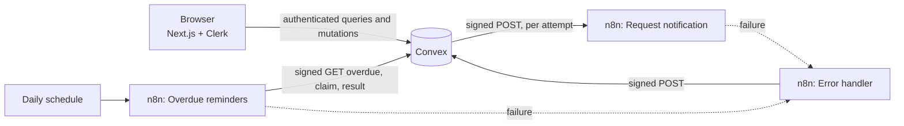

# LendLoop

**Borrow what you need. Lend what you don't.**

A neighborhood tool-lending board. Neighbors list tools, request them for a date range, approve or decline requests, and get automated notifications and overdue reminders through n8n.

Built with Next.js (App Router), Clerk, Convex, n8n and TypeScript.

**Live demo: <https://lendloop.15-252-231-30.sslip.io>**

- Sign in with Google or an email address. The board is preloaded with demo neighbors, listings and loans.
- It runs on a single AWS Lightsail instance with Docker Compose: the Next.js app, a self-hosted Convex backend and n8n, behind Caddy for HTTPS. n8n is not exposed to the internet; Convex and n8n talk over the private Docker network.
- The overdue reminder workflow runs daily at 09:00 UTC. One demo borrower always fails, so the admin page shows how failures surface.

- [Quick start](#quick-start)
- [See it work](#see-it-work)
- [Environment variables](#environment-variables)
- [Architecture](#architecture)
- [Automation design](#automation-design)
- [Security and data minimization](#security-and-data-minimization)
- [Decisions](#decisions)
- [Known limitations](#known-limitations)
- [Running in production](docs/PRODUCTION.md)

## Quick start

You need Node 20.9 or newer, Docker, and a free [Clerk](https://clerk.com) application. Convex runs locally and needs no account.

**1. Create the Clerk application.** In the Clerk dashboard, create an application, then enable the Convex integration (Configure > Integrations > Convex). Under Configure > Sessions > Customize session token, add `"name": "{{user.full_name}}"` next to the `aud` claim, so neighbors see each other's names. Without it, everyone shows as "Neighbor". Copy the publishable and secret keys from API keys.

**2. Install and configure.**

```bash
npm install
npm run setup
```

`setup` asks for the two Clerk keys, generates every secret, writes `.env.local` and configures Convex.

**3. Start n8n.** This imports the credentials and workflows and publishes them.

```bash
npm run n8n:up
```

**4. Start the app.** Open <http://localhost:3000>.

```bash
npm run dev
```

**5. Sign up in the app, then load the demo data.** In a second terminal:

```bash
npm run demo:seed
```

This makes you an admin and gives you listings, incoming requests and an overdue loan of your own, alongside three demo neighbors.

The n8n editor is at <http://localhost:5678>. To use Convex Cloud instead, run `npx convex login`, set `N8N_BASE_URL` to a public address for n8n when you run `setup`, and change `CONVEX_SITE_URL` in the **Prepare request** node of the *Signed Convex call* workflow.

## See it work

| Feature | Do this | Expect |
|---|---|---|
| Public board | Open `/` signed out | Only names and categories. Tools on loan are hidden. |
| Availability | Open **Tools** | Badges: Available, Booked from, On loan until, Overdue by N days. |
| Request flow | Request a tool, then approve it from the lender's side | The loan card shows "Approval notice sent". |
| Roles | As a non-admin, call any `admin.*` function | `FORBIDDEN`, enforced in Convex. |
| Overdue reminders | `npm run demo:overdue` | Each borrower gets a reminder. The seeded bounce address fails, the others still send, and the run ends red. |
| Failure visibility | Open **Admin** | The failed run and failed reminder are listed. |
| No duplicates | Run `npm run demo:overdue` again | Sent reminders stay at one attempt. Only the failed one retries. |
| Delivery retries | `npm run n8n:down`, approve a request, wait about 90 seconds | The notice shows as failed on **Admin**. Bring n8n back and press **Redeliver**. |
| Bad signature | `curl -i -X POST localhost:5678/webhook/lendloop-loan-event -d '{}'` | `401` with no detail, and no failure record. |

Retries are sped up locally by `NOTIFICATION_BACKOFF_SCALE`. Without it they run at 1, 3 and 10 minutes.

### Scripts

| Script | Purpose |
|---|---|
| `npm run dev` | Convex and Next.js together |
| `npm test` | Backend test suite |
| `npm run lint` / `npm run typecheck` | Static checks |
| `npm run n8n:up` / `npm run n8n:down` | Start or stop n8n |
| `npm run demo:seed` | Load demo data |
| `npm run demo:overdue` | Run the reminder workflow now |
| `npm run make-admin` | Promote the most recent real user |

## Environment variables

**`.env.local` (Next.js and Docker Compose)**

| Name | Source | Purpose |
|---|---|---|
| `NEXT_PUBLIC_CLERK_PUBLISHABLE_KEY` | Clerk | Client auth |
| `CLERK_SECRET_KEY` | Clerk | Server auth |
| `NEXT_PUBLIC_SITE_URL` | You | Optional. Public address used for canonical links, the sitemap and social previews. Defaults to `http://localhost:3000`. |
| `CONVEX_DEPLOYMENT`, `NEXT_PUBLIC_CONVEX_URL`, `NEXT_PUBLIC_CONVEX_SITE_URL` | Convex CLI | Deployment selection |
| `CONVEX_TO_N8N_SECRET`, `N8N_TO_CONVEX_SECRET` | `setup` | HMAC keys, one per direction |
| `N8N_ENCRYPTION_KEY` | `setup` | Encrypts n8n's credential store |

**Convex deployment (`npx convex env set`, all written by `setup`)**

| Name | Purpose |
|---|---|
| `CLERK_JWT_ISSUER_DOMAIN` | Validates Clerk tokens |
| `CONVEX_TO_N8N_SECRET`, `N8N_TO_CONVEX_SECRET` | HMAC keys |
| `N8N_LOAN_EVENT_URL`, `N8N_OVERDUE_RUN_URL` | Webhook addresses |
| `NOTIFICATION_BACKOFF_SCALE` | Optional. Shortens retries for local use. |
| `LENDLOOP_ALLOW_DEMO` | Optional. Enables the internal demo functions. |

In n8n, each HMAC key is stored in a Crypto credential. Exported workflows reference credentials by id and contain no secret values.

## Architecture



```text
app/              Routes: public board and member area
components/       UI
convex/           Schema, queries, mutations, HTTP endpoints
convex/lib/       Auth helpers, loan rules, HMAC, dates
n8n/workflows/    Exported workflows
tests/            Backend tests
scripts/          Setup and dev runner
docs/             Production notes
```

### Search and sharing

The public board is server-rendered, so its listings are in the HTML that crawlers fetch. It sets a title, description and canonical link, Open Graph and Twitter cards with a generated preview image, and JSON-LD for the organization, site and web app. `robots.txt` and `sitemap.xml` are generated from `NEXT_PUBLIC_SITE_URL`. Member pages are marked `noindex` and disallowed in `robots.txt`, since they sit behind sign-in.

### Loan lifecycle

```text
requested --> approved --> returned
requested --> declined
requested --> cancelled
approved  --> cancelled   (either party, until the start date)
```

Transitions live in one pure function, `assertTransition`. Rules worth knowing:

- Dates are UTC. Requests get one day of grace so a user west of UTC can pick their local today.
- Overlap is checked on request and again on approve. Convex mutations are serializable, so two racing approvals cannot both win.
- An overdue, unreturned loan blocks the tool until it is marked returned.
- Only the lender can mark a loan returned, otherwise a borrower could silence their own reminders.

## Automation design

Five workflows live in `n8n/workflows/`: two shared sub-workflows (sign and call Convex, verify a signature), request notification, overdue reminders, and the error handler.

### Signing

```text
X-LL-Timestamp: <unix seconds>
X-LL-Signature: v1=<hex HMAC-SHA256>

signed string = <timestamp>.<METHOD>.<path>.<raw body>
```

- Each direction has its own secret, so one leak does not expose the other direction.
- Method and path are signed, so a signature cannot be replayed against another endpoint.
- Timestamps older than five minutes are rejected.
- Comparison is constant time on both sides. Malformed signatures count as invalid instead of throwing, so anonymous traffic cannot trigger the error workflow.

### Convex to n8n

The mutation that changes a loan inserts a `notifications` row and schedules `tick` in the same transaction, so a rolled-back change can never send a notification.

Convex runs scheduled mutations exactly once but actions at most once. `tick` therefore holds the retry state: it counts the attempt, schedules `deliver` and schedules the next `tick`. If `deliver` dies, the next tick still runs. Each attempt signs again with a fresh timestamp.

n8n responds after notifying, so a 2xx is a delivery receipt. n8n deduplicates on `eventId:attempt`, which drops replays and lets genuine retries through.

### n8n to Convex

All calls go through the *Signed Convex call* sub-workflow. Retrying its parent node restarts the sub-workflow, so a retried execution never reuses an expired signature.

Reminders are **claimed before sending**, under `reminder:<loanId>:<date>`:

| Existing row | Claim result |
|---|---|
| None | Inserted, claimed |
| `failed` | Re-opened, claimed |
| `pending` or `sent` | Not claimed |
| Loan returned, not overdue, or wrong date | Not claimed |

### Delivery guarantees

| Flow | Guarantee | Remaining edge |
|---|---|---|
| Loan events | At least once | If n8n's response is lost after notifying, the retry notifies again. |
| Reminders | At most once per loan per day | If n8n crashes after sending, that day's outcome shows as unknown and tomorrow's key retries. |

Exactly-once delivery across two systems is not achievable, so the design picks a direction for each flow and states it.

### Failure handling

| Failure | Behavior | Visible in |
|---|---|---|
| n8n down | Retries at 1, 3, 10 minutes, then `failed` | Admin, with Redeliver |
| `deliver` crashes | Next `tick` retries | Attempt count |
| Bad, expired or short signature | `401`, nothing processed | n8n executions |
| Replay within the window | Dropped, `200` | n8n executions |
| One borrower fails | The rest still send, then the run ends red | Loan activity, Admin |
| Workflow execution fails | Error handler reports it, keyed on execution id | Admin |

## Security and data minimization

### Access control

Every public Convex function calls a helper from `convex/lib/auth.ts`. Identity comes only from the verified token. The client never supplies a user id or role. HTTP endpoints and scheduled work call internal functions only. The first admin is created from the CLI, and no UI path changes a role.

Role and ownership are separate: an admin has no owner rights over someone else's tool, and is an ordinary owner of their own.

| Action | Public | Member | Lender | Borrower | Admin role |
|---|---|---|---|---|---|
| Public list | Yes | Yes | Yes | Yes | Yes |
| Member list with availability | | Yes | Yes | Yes | Yes |
| Create listing | | Yes | Yes | Yes | Yes |
| Edit or delete listing | | | Yes | | Remove only |
| Request to borrow | | Yes | | | Yes |
| Approve, decline, mark returned | | | Yes | | |
| Cancel | | | Approved loans | Yes | |
| View all loans, Trusted Lender | | | | | Yes |

### What leaves each boundary

| Flow | Sent | Deliberately not sent |
|---|---|---|
| Public board | name, category | owner, description, condition, dates |
| Member list | owner display name, Trusted badge, dates | borrower identity |
| Convex to n8n | ids, tool name, dates, first name | email, description, pickup note |
| Overdue endpoint | loan id, key, first name, tool, due date | email, lender identity |
| Error handler | workflow, execution id, failed node | payload, user data |

Exact-key tests pin the public list, the webhook payload and the overdue response, so a new field cannot slip out unnoticed.

Other decisions:

- Email addresses stay in Clerk. Convex stores only a display name.
- A pickup note is visible only to the two parties, is capped at 200 characters, is excluded from admin views, audit entries, n8n and logs, and is deleted when the loan ends.
- Clients receive stable error codes, never internal detail. Logs carry ids only.
- Listings are soft deleted, so history stays intact. Every loan transition and admin action writes an audit entry.
- Secrets live in environment variables and n8n credentials. `N8N_BLOCK_ENV_ACCESS_IN_NODE` stays on, and generated credential files are ignored by git.
- n8n execution data is pruned after seven days.

## Decisions

| Decision | Alternative considered | Why |
|---|---|---|
| Retry state in a scheduled mutation | Retry loop inside the action | Actions run at most once. A crash would strand the row with no record. |
| Claim before sending | Idempotent write-back only | Write-back alone cannot stop a second send after a partial failure. |
| Respond after notifying | Respond 202 early, write back later | One less endpoint and state, and the status code already says what happened. |
| One `notifications` table | Separate outbox and activity tables | One notification, one row. The activity feed reads from it directly. |
| HMAC in n8n's Crypto credential | Read secrets from `$env` in a Code node | Env access is off by default in n8n 2, and credentials keep secrets out of workflow JSON. |
| Role stored in Convex | Role in Clerk metadata and the JWT | One source of truth, and a role change applies immediately rather than at token refresh. |
| `activeLoan` stored on the tool | Compute availability from the clock | Convex queries should not depend on `Date.now()`: subscriptions would go stale. |
| Demo tooling through internal functions | Demo buttons behind an env flag | No client path exists to a privileged action, even when misconfigured. |

## Known limitations

- A reminder that failed mid-run is retried by the next run, not within the same day's schedule.
- A valid signed request can be replayed within five minutes. Writes are idempotent, and notifications are deduplicated.
- No rate limiting on anonymous reads or request creation.
- "Overdue" is computed in UTC rather than each user's time zone.
- A daily run that never starts shows only as an absence of activity.

See [docs/PRODUCTION.md](docs/PRODUCTION.md) for how each of these would be addressed.

## Testing

```bash
npm test
```

The suite covers the RBAC matrix, loan transitions and date rules, overlap, claim idempotency, retry state, signature handling (valid, tampered, expired, short, replayed across endpoints) and exact response shapes.
